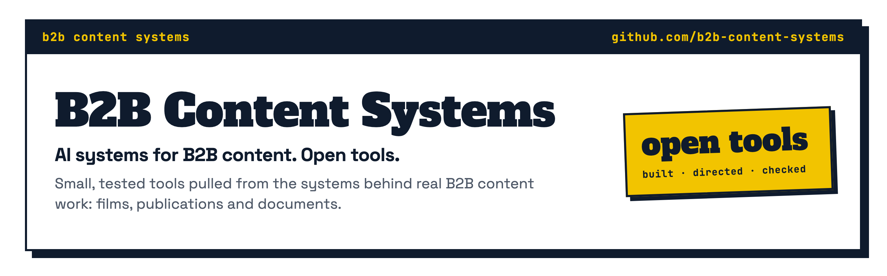

<picture>
  <source media="(prefers-color-scheme: dark)" srcset="https://raw.githubusercontent.com/b2b-content-systems/.github/main/profile/assets/org-banner-dark.png">
  
</picture>

B2B Content Systems builds the systems a marketing team uses to ship content that used to need a studio: films, publications, web pages and documents. The tools here come out of that work. Each one is small, tested on every change, and MIT-licensed.

### Tools

| Tool | What it does | Tests | Release |
|---|---|---|---|
| [**ats-resume-check**](https://github.com/b2b-content-systems/ats-resume-check) | Finds the résumé PDFs an applicant tracking system cannot read, before you send them |  | [v0.1.0](https://github.com/b2b-content-systems/ats-resume-check/releases) |
| [**llm-fallback**](https://github.com/b2b-content-systems/llm-fallback) | Keeps a tool working when Claude is down by asking Gemini, and says which model answered |  | [v0.1.0](https://github.com/b2b-content-systems/llm-fallback/releases) |

### Standards for every tool

- **Tested on every change**, on Python 3.10, 3.12 and 3.13.
- **No surprise dependencies.** Standard library where possible; anything else is named in the README.
- **Fails loudly.** A tool says what went wrong and what to do next.
- **MIT licence.** Use it at work.

### Who runs this

[Bryan Bartlett](https://github.com/bryanbartlett), creative director, Boston, MA. Fifteen years of brand and content for marketing technology at GumGum, Adweek BrandShare, Chango and Dibbs. Contact: [bryanbartlett.com/about](https://bryanbartlett.com/about#contact).
